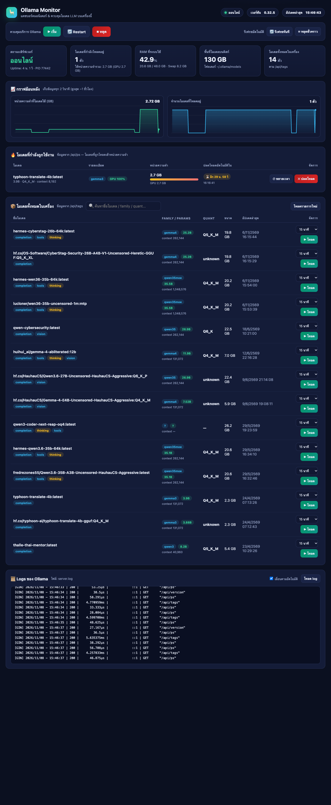

# 🦙 Ollama Monitor

> Web dashboard for **monitoring & controlling local Ollama LLM models** — see which model is
> being used right now, memory usage, load/unload models, and start/stop/restart the Ollama service.
>
> (ภาษาไทย) แดชบอร์ดเว็บสำหรับมอนิเตอร์ + ควบคุมโมเดล LLM บน Ollama — เห็นว่าโมเดลไหนกำลังถูกใช้งาน
> ใช้หน่วยความจำเท่าไหร่ โหลด/ปลดโหลดโมเดลได้ และสั่ง เริ่ม/หยุด/Restart บริการ Ollama ได้จากหน้าเว็บ



## ✨ Features

| ส่วน | รายละเอียด |
|---|---|
| โมเดลที่กำลังใช้งาน | ชื่อโมเดล, family, params, quant, context, หน่วยความจำ (RAM/GPU), นับถอยหลังปลดโหลดอัตโนมัติ |
| จัดการโมเดล | โหลด (เลือก keep_alive: 5 นาที – 24 ชม. / ถาวร), ปลดโหลด, ขยายเวลา |
| ควบคุมบริการ | เริ่ม / Restart / หยุด Ollama.app (มี confirm dialog สำหรับคำสั่งอันตราย) |
| กราฟย้อนหลัง | หน่วยความจำที่โมเดลใช้ + จำนวนโมเดลที่โหลด (เก็บทุก 2 วิ ~1 ชม.) |
| สถานะระบบ | RAM ที่ใช้ทั้งเครื่อง, Swap, พื้นที่โมเดลบนดิสก์ |
| Logs | Tail log สดของ Ollama (`~/.ollama/logs/server*.log`) |
| ค้นหา | กรองตารางโมเดลตามชื่อ / family / quant |

## 🚀 Quick Start (Docker)

```bash
git clone https://github.com/Fernlizer/ollama-monitor.git
cd ollama-monitor
./install.sh
```

เปิด **http://localhost:9020**

`install.sh` ทำ 3 อย่างให้อัตโนมัติ:

1. ติดตั้ง **host agent** เป็น launchd service (auto-start ตอนเปิดเครื่อง) — ตัวที่ทำหน้าที่
   ซึ่ง container ทำไม่ได้ เช่น อ่าน metrics ของเครื่องจริง และสั่ง เริ่ม/หยุด/Restart Ollama.app
2. Build + รัน **dashboard ใน Docker** (`docker compose up -d`, restart อัตโนมัติ)
3. ตรวจสอบว่าทุกอย่างตอบสนอง

> ทางเลือก — รันแบบไม่ใช้ Docker (host mode): `./start.sh`

## 🏗 Architecture

```
┌───────────────────────────── Docker ─────────────────────────────┐
│  ollama-monitor (FastAPI + UI, port 9020)                        │
│    ├─ proxy Ollama API ──────────────► host.docker.internal:11434│
│    ├─ metrics + service control ─────► host.docker.internal:9021 │
│    └─ logs (read-only mount) ◄────── ~/.ollama/logs              │
└──────────────────────────────────────────────────────────────────┘
┌───────────────────────────── macOS host ─────────────────────────┐
│  host-agent (stdlib Python, launchd, port 9021)                  │
│    ├─ GET /metrics   proc CPU/RAM, system RAM/Swap, disk usage   │
│    └─ POST /service  start / stop / restart Ollama.app           │
│  Ollama.app (port 11434)                                         │
└──────────────────────────────────────────────────────────────────┘
```

ทำไมต้องมี host agent? — container ไม่สามารถมองเห็นหรือส่งสัญญาณไปยัง process บนเครื่อง host ได้
จึงแยกงานที่ต้องแตะ macOS จริง (osascript, ps, vm_stat, du) ไว้ที่ agent เล็ก ๆ ตัวนี้
(ไม่มี dependency ใด ๆ ใช้แค่ Python stdlib)

## 🔌 API ของตัว dashboard

| Endpoint | คำอธิบาย |
|---|---|
| `GET /api/overview` | ภาพรวม + history สำหรับกราฟ |
| `GET /api/models` | โมเดลทั้งหมด (proxy `/api/tags`) |
| `GET /api/running` | โมเดลที่โหลดอยู่ (proxy `/api/ps`) |
| `POST /api/models/load` | `{"name": "...", "keep_alive": "15m"}` — โหลด/ขยายเวลา |
| `POST /api/models/unload` | `{"name": "..."}` |
| `GET /api/logs?lines=250` | Tail log ล่าสุด |
| `POST /api/service` | `{"action": "start" \| "stop" \| "restart"}` |

โหลด/ปลดโหลดโมเดลใช้ `POST /api/generate` + `keep_alive` (ไม่สร้าง token):
`keep_alive: "30m"` → `done_reason: "load"`, `keep_alive: 0` → `done_reason: "unload"`

## ⚙️ Configuration (env)

| ตัวแปร | ค่าเริ่มต้น | คำอธิบาย |
|---|---|---|
| `OLLAMA_URL` | `http://localhost:11434` | ที่อยู่ Ollama API (ใน Docker เป็น `host.docker.internal`) |
| `HOST_AGENT_URL` | *(ว่าง = host mode)* | ที่อยู่ host agent เมื่อรันใน Docker |
| `OLLAMA_APP_NAME` | `Ollama` | ชื่อแอปที่สั่ง start/stop |
| `OLLAMA_LOG_DIR` | `~/.ollama/logs` | โฟลเดอร์ log ของ Ollama |
| `PORT` | `9020` | พอร์ตของ dashboard |

## 🔒 หมายเหตุด้านความปลอดภัย

- ทั้ง dashboard และ host agent bind เฉพาะเครื่องตัวเอง (`127.0.0.1`) เพราะมีปุ่มควบคุมบริการ
  — ถ้าจะเปิดให้เครื่องอื่นเข้า ควรเพิ่ม authentication ก่อน
- ปุ่ม Restart/หยุด จะปลดโหลดโมเดลทั้งหมดออกจากหน่วยความจำ (พฤติกรรมปกติของ Ollama)

## 🧪 ทดสอบแล้ว

- Ollama 0.32.5 บน macOS + Docker Desktop — ทดสอบ load/unload/restart/stop/start จริงทุกปุ่ม
  ทั้งผ่าน API และผ่าน UI บนเบราว์เซอร์
- รองรับ Ollama ที่รันทั้งแบบ Ollama.app และ `ollama serve` (CLI)

## License

MIT
